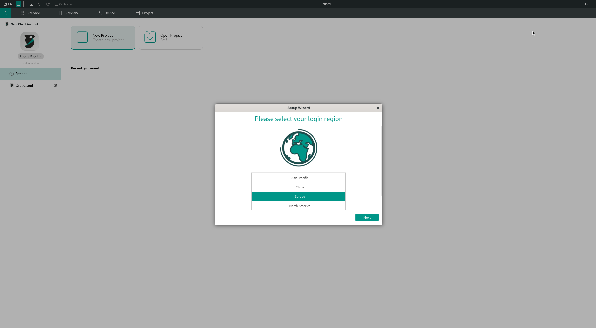
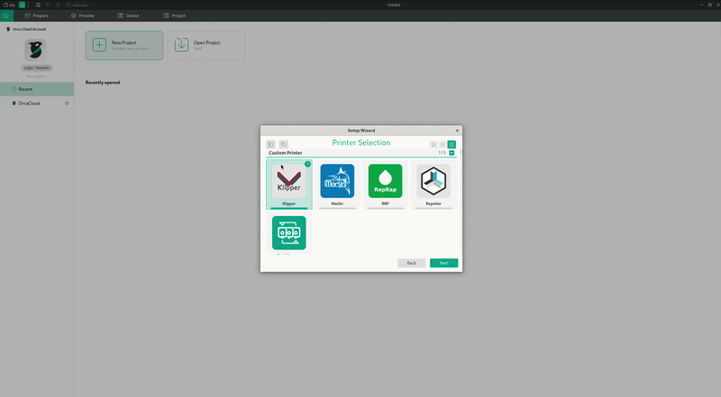

# Adding printers

This page will show you how you can add our printers and Filaments to the orca.

## From the setup wizard

### Printers

In the welcome screen select region you are located in and press `Next`

<figure markdown="span">
  { width="1000" }
  <figcaption>Welcome screen</figcaption>
</figure>

Next enter the search mode and start typing `FELIX` this should show you all the printers that we support with this application. Note that you can select more then one printer.

You can also however onto the to right corner in the printer`s card to show all the nozzle widths that that this printer supports.

<figure markdown="span">
  { width="1000" }
  <figcaption>Image caption</figcaption>
</figure>

Once your printers are selected press next to select filaments you want to use.

!!! tip

    This selection procedure can be executed at any time to add or remove printers and filaments, so no worries if you accidentally did not select something you own and want to configure it

### Filaments

Depending on what printers you have selected a list of materials will show you which mate
