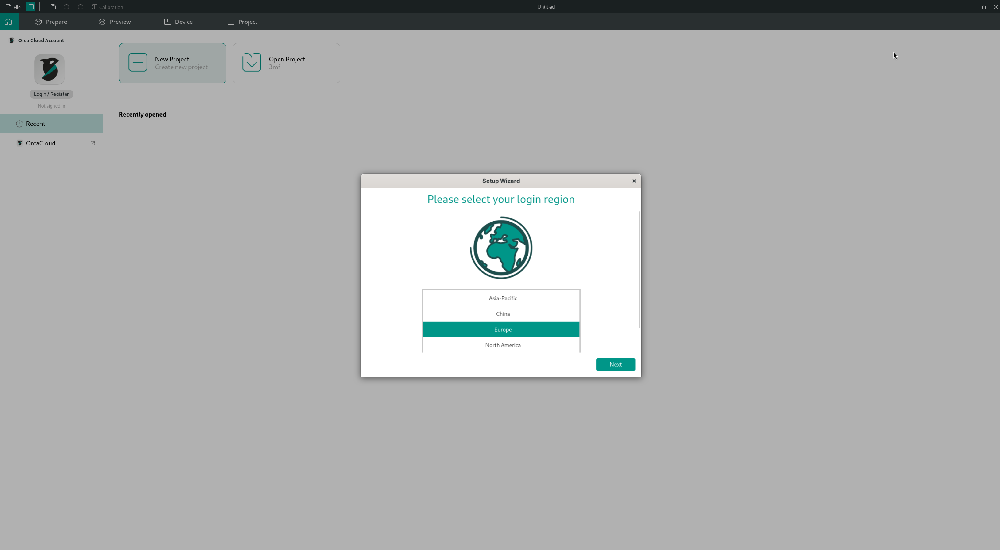
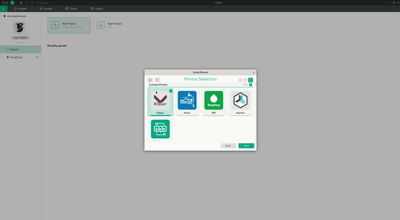
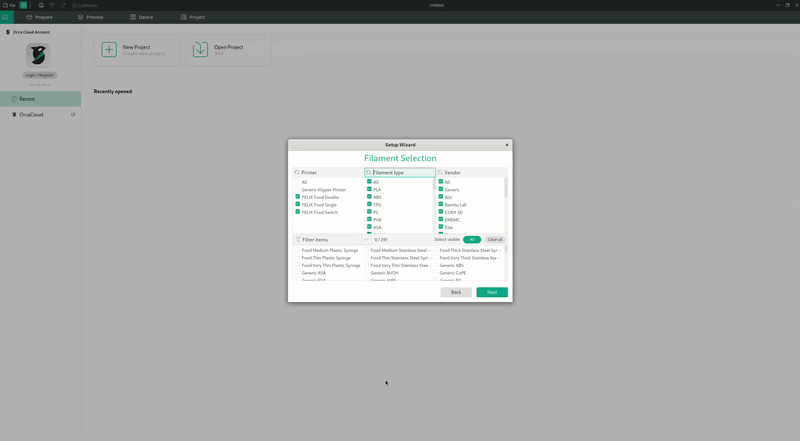
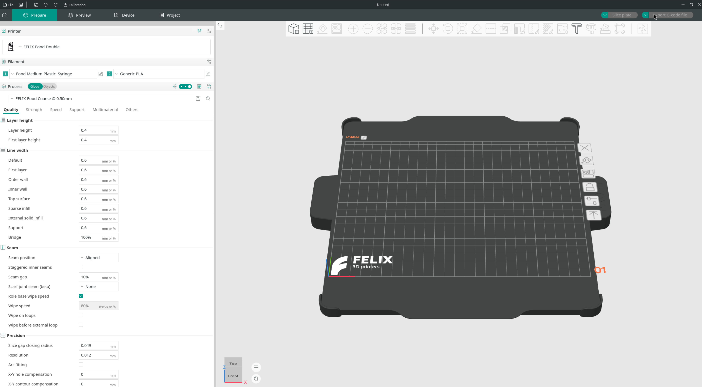
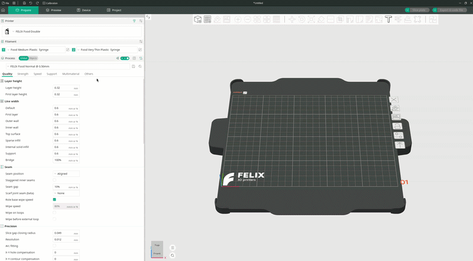
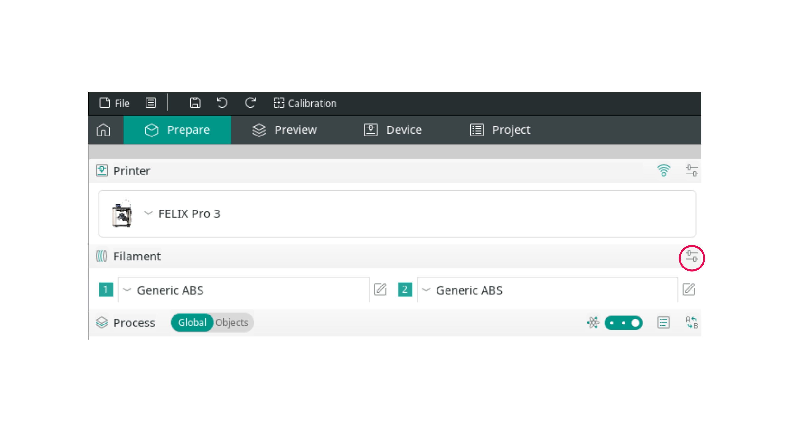
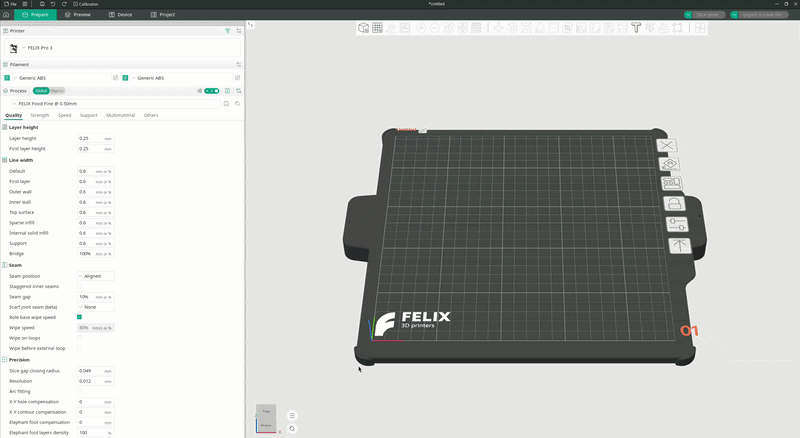

# Printers toevoegen

Op deze pagina lees je hoe je onze printers en filamenten aan Orca toevoegt.

## Via de installatiewizard

### Printers

Selecteer op het welkomstscherm de regio waarin je je bevindt en klik op `Next`.

<figure markdown="span">
  { width="700" }
<figcaption>Welkomstscherm</figcaption>
</figure>

Open vervolgens het zoekveld en begin `FELIX` te typen. Je ziet dan alle printers die door de applicatie worden ondersteund. Je kunt meer dan één printer selecteren.

Beweeg met je muis over de rechterbovenhoek van een printerkaart om alle nozzlediameters te zien die die printer ondersteunt.

<figure markdown="span">
  { width="700" }
<figcaption>Printers selecteren uit de lijst</figcaption>
</figure>

Klik op `Next` zodra je je printers hebt geselecteerd, om de filamenten te kiezen die je wilt gebruiken.

!!! tip

    Je kunt deze selectie op elk moment opnieuw doorlopen om printers en filamenten toe te voegen of te verwijderen. Geen zorgen dus als je iets bent vergeten te selecteren.

### Filamenten

Op basis van de geselecteerde printers wordt een lijst met geschikte materialen getoond. Voeg in dit menu de materialen toe waarmee je wilt werken.

<figure markdown="span">
  { width="700" }
<figcaption>Filamenten selecteren in het menu</figcaption>
</figure>

!!! note

    Orca ondersteunt het wisselen van de voedselspuit niet. Selecteer daarom het filament samen met de spuit die de printer voor de extrusie gebruikt.

Klik op `Next` zodra je je filamenten hebt geselecteerd, om verder te gaan met de installatie.

### Afronden

Klik door de resterende installatiestappen met `Next`. Daarna verschijnt je printbed in het hoofdvenster, klaar voor gebruik.

<figure markdown="span">
  { width="700" }
<figcaption>Hoofdvenster</figcaption>
</figure>

## Via het hoofdvenster

### Printers

Om vanuit het hoofdvenster nieuwe printers toe te voegen, klik je op het printer-dropdownmenu linksboven in het scherm en kies je de optie `-- Select/Remove printer (from system presets) --`. Je krijgt dan hetzelfde venster te zien als in de installatiewizard, waarin je printers kunt selecteren of deselecteren.

<figure markdown="span">
  { width="700" }
<figcaption>Printers toevoegen via het printer-dropdownmenu</figcaption>
</figure>

### Filamenten

Om een nieuw filament toe te voegen, klik je op het kleine schuifregelaar-icoon naast het filamentgedeelte.

<figure markdown="span">
  { width="700" }
<figcaption>Het schuifregelaar-icoon naast het filamentgedeelte</figcaption>
</figure>

Hiermee open je hetzelfde menu dat je tijdens de eerste installatie gebruikte, dus je selecteert filamenten op dezelfde manier als toen.

<figure markdown="span">
  { width="700" }
<figcaption>Filamenten selecteren vanuit het hoofdvenster</figcaption>
</figure>
