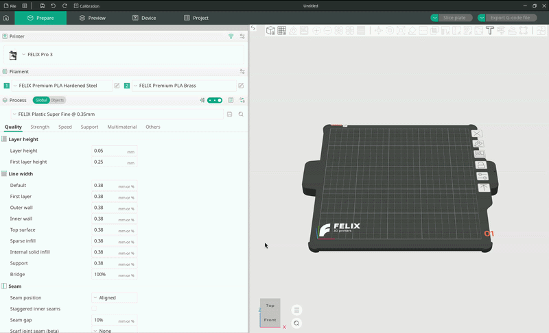
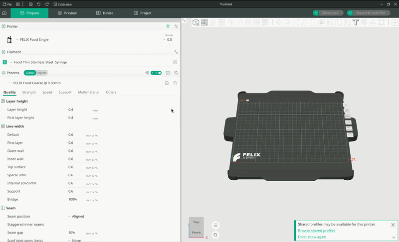
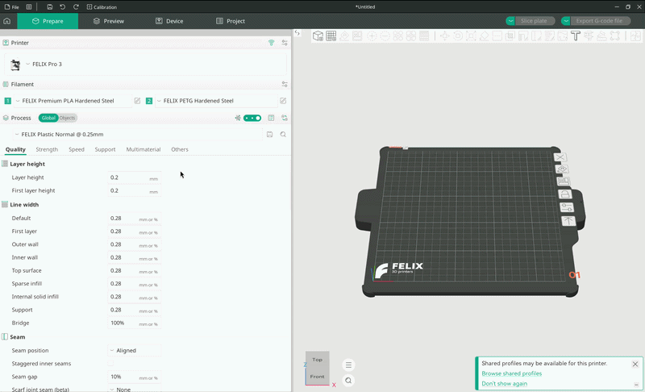
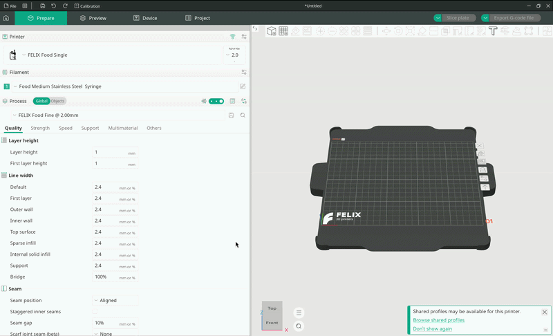
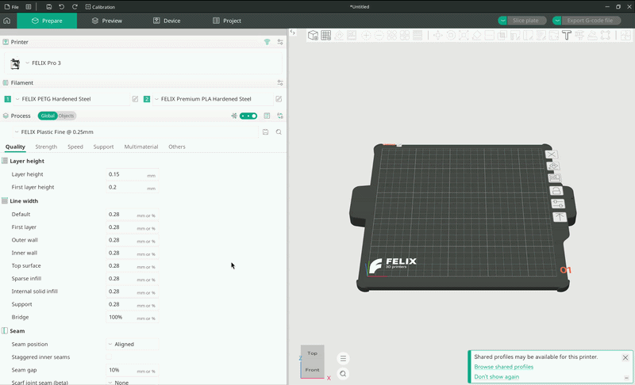
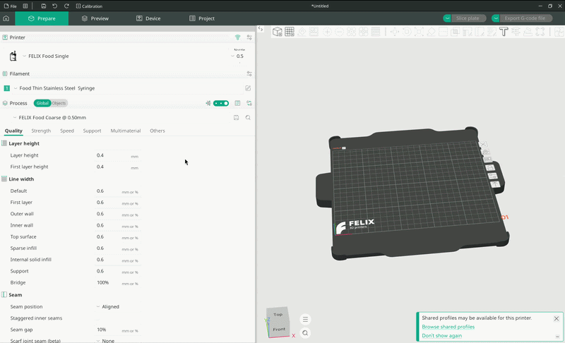

# Configuring

Before you can start printing, you need to configure four main settings:

- Printer
- Nozzle size
- Filament (for each nozzle)
- Quality preset (process)

This guide walks you through each of them. All four settings are located in the leftmost panel of OrcaSlicer, and we will cover them in the order they appear there.

## Printers

Once you have added the printers you want to use, you can switch between their configurations using the printer drop-down menu.

If you haven't added any of our printers yet, follow the [Adding printers guide](Adding%20printers.md) first.

<figure markdown="span">
  { width="1000" }
  <figcaption>Printer configuration pop-up</figcaption>
</figure>

## Nozzle sizes

### Dual-nozzle printers

Most of our printers come with two nozzles. Unfortunately, OrcaSlicer does not yet offer an intuitive way to choose between nozzle sizes on printers with two or more nozzles.

To select a configuration with a different nozzle diameter, click the small rectangular icon with a pen next to the printer's name. This opens a pop-up window showing various printer settings.

At the very top of this window is a drop-down menu listing many printer configurations. Find the one that matches your printer model and nozzle size.

<figure markdown="span">
  { width="1000" }
  <figcaption>Selecting a printer configuration</figcaption>
</figure>

### Single-nozzle printers

Changing the nozzle size on a single-nozzle printer is much more straightforward.

Our only single-nozzle printer is the `FOOD Single`. When it is selected, you can change the nozzle diameter using the small button labeled `Nozzle` next to the printer's name. Click it to reveal the available nozzle diameters, then choose the size you want from the drop-down menu.

<figure markdown="span">
  { width="1000" }
  <figcaption>Nozzle selection on single-nozzle printers</figcaption>
</figure>

## Filaments

This section assumes you have already loaded the filament profiles for your printer.

If you haven't, follow the `Filament` section of the [Adding printers guide](Adding%20printers.md).

### Plastic

For plastic printers, we provide material presets for different nozzle types. Specifically, each material comes in a **Brass** and a **Hardened steel** variant, matching the type of extruder you have installed.

You can select the material for each nozzle individually using the two drop-down menus in the **Filament** section. Note that OrcaSlicer uses nozzle _1_ as its default extruder.

!!! tip

    Our profiles are configured so that you can't select a material your printer doesn't support.

    For example, food filaments can't be selected for a plastic printer, and vice versa.

To select a filament, click one of the drop-down menus to show the list of vendors. Hover over `FELIX Printers` to open a submenu, then select the specific filament you want.

<figure markdown="span">
  { width="1000" }
  <figcaption>Filament selection on a dual-nozzle plastic / food printer</figcaption>
</figure>

For example, if you have a hardened steel extruder mounted on your printer and are using our Premium PLA, select `FELIX Premium PLA Hardened steel`. This sets the printing temperatures and all other settings required for a successful print.

### Food

The principle for food printers is the same, but instead of choosing a material and extruder type, you select the thickness of the food (its viscosity) and the type of syringe you are using.

For more information, see our [Food printing guide](./Food%20printing%20guide.md). Use the tables below to choose the correct filament preset for your food printer.

<figure markdown="span">
  { width="1000" }
  <figcaption>Filament selection on a food printer</figcaption>
</figure>

#### Basic Plastic: Plastic Syringe

| Level | Class     | Viscosity (mPa·s) | Examples                      |
| :---: | --------- | ----------------- | ----------------------------- |
|   3   | Medium    | 10,000 – 30,000   | Mustard, mayonnaise           |
|   2   | Thin      | 3,000 – 10,000    | Liquid honey, custard         |
|   1   | Very Thin | 1,000 – 3,000     | Molten chocolate, thick syrup |

#### Premium Stainless Steel: Stainless Steel Syringe

| Level | Class      | Viscosity (mPa·s) | Examples                               |
| :---: | ---------- | ----------------- | -------------------------------------- |
|   5   | Very Thick | 100,000 – 300,000 | Thick peanut butter, soft cookie dough |
|   4   | Thick      | 30,000 – 100,000  | Tomato paste, thick Greek yogurt       |
|   3   | Medium     | 10,000 – 30,000   | Mustard, mayonnaise                    |
|   2   | Thin       | 3,000 – 10,000    | Liquid honey, custard                  |
|   1   | Very Thin  | 1,000 – 3,000     | Molten chocolate, thick syrup          |

!!! tip "Example"

    To print liquid honey with a stainless steel syringe, select the filament labeled `Food Thin Stainless Steel Syringe`.

## Processes

"Process" is OrcaSlicer's term for a quality preset. This is where you (or we, through our presets) balance print detail against print speed, among other things.

### Plastic

Our plastic quality presets follow the naming pattern below, each favoring either speed or detail:

- FELIX Plastic Very Coarse @ {nozzle diameter} mm
- FELIX Plastic Coarse @ {nozzle diameter} mm
- FELIX Plastic Slightly coarse @ {nozzle diameter} mm
- FELIX Plastic Normal @ {nozzle diameter} mm
- FELIX Plastic Fine @ {nozzle diameter} mm
- FELIX Plastic Very fine @ {nozzle diameter} mm

From top to bottom, print quality increases, but so does printing time.

!!! tip

    The most important setting in a process preset is `Layer height`, which determines how many layers the model is printed with. Thinner layers mean more layers and finer detail, but also a longer print.

    If our presets don't quite match your expectations, you can adjust the layer height to get the results you want.

<figure markdown="span">
  { width="1000" }
  <figcaption>Process selection on a plastic printer</figcaption>
</figure>

### Food

Applying quality settings for food printing works much the same way as for plastic. The key difference is that supports (structures the printer builds to keep the model from collapsing) are disabled.

There are two reasons for this. First, with food, the support structure would almost certainly merge with the product itself, leaving you with an unwanted shape. Second, unlike plastic, most foods don't solidify, so a model printed on supports would still depend on them after printing finished, and they couldn't be removed.

To select a process, click the process drop-down menu and choose a level of detail:

- FOOD Coarse
- FOOD Normal
- FOOD Fine

As with plastic printing, each step up increases print quality along with printing time.

<figure markdown="span">
  { width="1000" }
  <figcaption>Process selection on a plastic printer</figcaption>
</figure>
