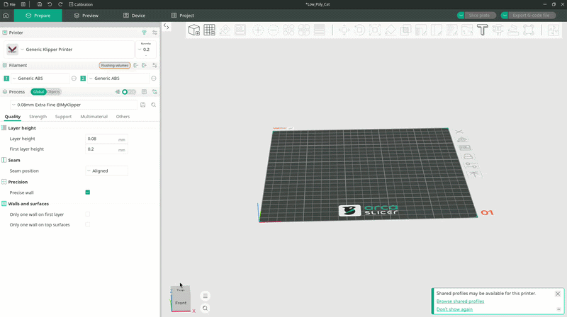

# Configuring

In order to start printing you first must select 4 main things

- Printer
- Its nozzle size
- Filament (for each nozzle)
- Quality preset

We will slowly go through each and show you how to do it.

Those settings can be found on the leftmost menu of the orca slicer. We will go through them in the order as displayed in the window.

## Printers

If you added printers you want orca to use, you can use the same drop down menu to also select different printer configuration.

If you have not added any our printer to the list, please follow [Adding printers guide](Adding%20printers.md)

<figure markdown="span">
  { width="1000" }
  <figcaption>Printer configuration pop-up</figcaption>
</figure>

## Nozzle sizes

### Double nozzle printers

Most of our printers come with two nozzles. Unfortunately, orca does not yet support printers that have two different nozzles, nor does it support intutive selection between various nozzle sizes.

To select configuration with different nozzle diameter you need to click on small rectagular icon with the pen right next to the printer`s name.

This will open a small pop-up window where you can see various printer settings.

On the very top, however, you will see a drop down menu with lot of printers to select from. This is where you have to find the model name of the printer you own and its nozzle size.

<figure markdown="span">
  { width="1000" }
  <figcaption>Selection of different printers</figcaption>
</figure>

### Single nozzle printers

For single nozzle printers changing nozzle size is much more straight forward.

Only printer with single nozzle is `FOOD Single`. When this printer is selected, you can switch between different nozzle diameters simply by pressing small button right next to the printers name. This button is labeled `Nozzle` and once you click it various nozzle diameters will be revealed. You can switch between them by selecting desired size from the dorp down menu.

<figure markdown="span">
  { width="1000" }
  <figcaption>Nozzle selection on single nozzle printers</figcaption>
</figure>

## Filaments

Thi section is again going to assume that the fillament of the printer which we support was loaded.

If you have not done so, you can follow `Filament` section of the [Adding printers guide](Adding%20printers.md)

### Plastic

For a plastic printer we ship various materials presets for different extruder nozzle types. More specifically we support **Brass** and **Hardened steel** variants of the each suited for different extruder type.

The material can be selected for individual nozzles in the two drop down menus under the **Filament** section. Note that orca uses nozzle _1_ as its default extruder.

!!! tip

    We have configured our profiles in a way so that you can not select material type which is not supported by the printer.

To select the filament click on one of the drop down menus which will show you the drop down with various vendors. However over `FELIX Printers` which will roll up another burger menu through which you can select specific filament type.

For example, when you have a Hardened steel extruded mounted to your printer and you have our premium PLA material you need to select `FELIX Premium PLA Hardened steel` this will configure printing temperatures and all the other settings required for hte successful print.

### Food

Principle with food printers is the same, however instead of concrete material and extruder type you are selecting food thickness AKA viscosity and syringe type you are using.

For more informtaion visit our [Food printing guide](./Food%20printing%20guide.md). This is the table you can use when selecting correct filament preset for the food printers

### Basic Plastic: Plastic Syringe

| Level | Class     | Viscosity (mPa·s) | Examples                      |
| :---: | --------- | ----------------- | ----------------------------- |
|   3   | Medium    | 10,000 – 30,000   | Mustard, mayonnaise           |
|   2   | Thin      | 3,000 – 10,000    | Liquid honey, custard         |
|   1   | Very Thin | 1,000 – 3,000     | Molten chocolate, thick syrup |

### Premium Stainless Steel: Stainless Steel Syringe

| Level | Class      | Viscosity (mPa·s) | Examples                               |
| :---: | ---------- | ----------------- | -------------------------------------- |
|   5   | Very Thick | 100,000 – 300,000 | Thick peanut butter, soft cookie dough |
|   4   | Thick      | 30,000 – 100,000  | Tomato paste, thick Greek yogurt       |
|   3   | Medium     | 10,000 – 30,000   | Mustard, mayonnaise                    |
|   2   | Thin       | 3,000 – 10,000    | Liquid honey, custard                  |
|   1   | Very Thin  | 1,000 – 3,000     | Molten chocolate, thick syrup          |

!!! tip "Example"

    Say, you want to print liquid honey with a stainless steel syringe. To do so, you have to select filament labeled `Food Thin Stainless Steel Syringe`.

## Processes

Process is another name for quality presets, in other words this is where you (or us) make evaluate the trade off between detailers and quality of the print among other things.

### Plastic

The quality presets come in the following formats each targeting either speed or how detailed the print will be.

- FELIX Plastic Very Coarse @ {nozzle diameter} mm
- FELIX Plastic Coarse @ {nozzle diameter} mm
- FELIX Plastic Slightly coarse @ {nozzle diameter} mm
- FELIX Plastic Normal @ {nozzle diameter} mm
- FELIX Plastic Fine @ {nozzle diameter} mm
- FELIX Plastic Very fine @ {nozzle diameter} mm

From top to bottom the quality of the print increases but with it, also its printing time.

!!! tip

    The most important setting in the process presets is the `Layer height` which dictates how manly layers should the model have. The more layers it has the more detailed it will be. But as more layers it has the slower the printer will become.

    So if you our processes do not match your expectations you can always tweak with the layer height value to get to the desired results.

### Food

The process of applying various quality controls does not largely differ from the plastic printing. The most important setting is that the supports (structures build by 3D printer in order for the model to not collapse) are disabled.

This is because when printing with food, the shape of hte support structure would most definitely interfere / fuse together with the main product you are about to print which would result in a shape that is not desirable. Another reason to disable the support structures is that unlike plastic, most of the foods od not solidify which means that they require support structure even after they have finished printing.

To select different process configuration, simply click on the process drop-down menu and select choose a level of detail from the options presented.

- FOOD Coarse
- FOOD Normal
- FOOD Fine

As withe the plastic printing the quality of the model increases with each quality preset, together with its printing time.
