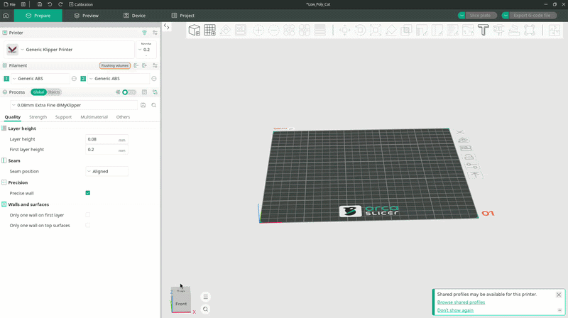
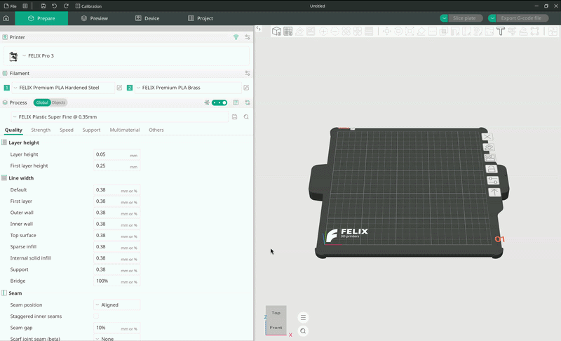
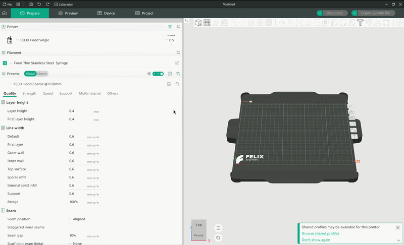
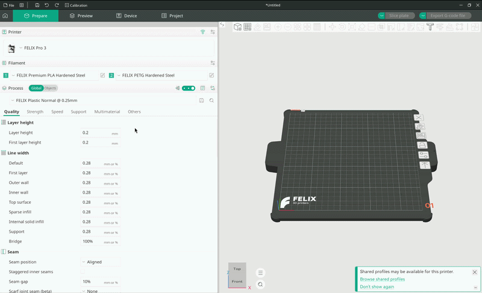
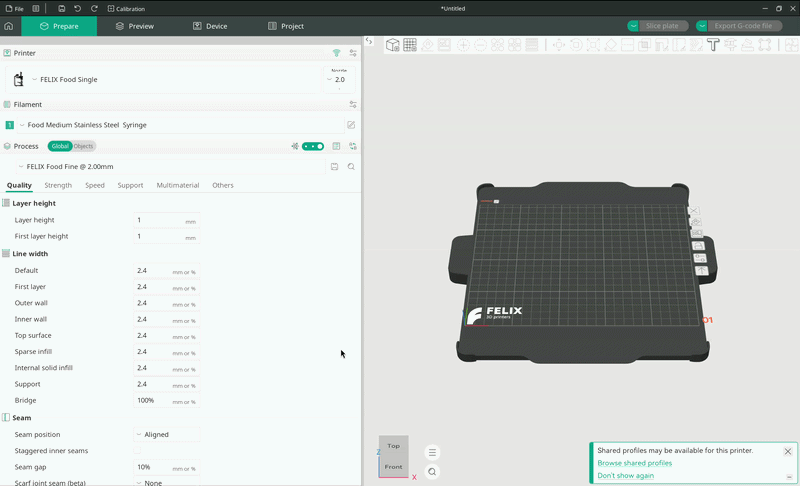

# Configureren

Voordat je kunt beginnen met printen, moet je vier hoofdinstellingen configureren:

- Printer
- Nozzlegrootte
- Filament (voor elke nozzle)
- Kwaliteitsinstelling (proces)

Deze handleiding leidt je door elk van deze instellingen. Alle vier bevinden ze zich in het meest linkse paneel van OrcaSlicer, en we behandelen ze in de volgorde waarin ze daar verschijnen.

## Printers

Zodra je de printers hebt toegevoegd die je wilt gebruiken, kun je via het vervolgkeuzemenu voor printers tussen hun configuraties wisselen.

Als je nog geen van onze printers hebt toegevoegd, volg dan eerst de handleiding [Printers toevoegen](Adding%20printers.md).

<figure markdown="span">
  { width="1000" }
  <figcaption>Pop-upvenster voor printerconfiguratie</figcaption>
</figure>

## Nozzlegroottes

### Printers met twee nozzles

De meeste van onze printers hebben twee nozzles. Helaas biedt OrcaSlicer nog geen intuïtieve manier om tussen nozzlegroottes te kiezen bij printers met twee of meer nozzles.

Om een configuratie met een andere nozzlediameter te selecteren, klik je op het kleine rechthoekige icoon met een pen naast de naam van de printer. Hiermee open je een pop-upvenster met verschillende printerinstellingen.

Helemaal bovenaan dit venster staat een vervolgkeuzemenu met een groot aantal printerconfiguraties. Zoek de configuratie die overeenkomt met jouw printermodel en nozzlegrootte.

<figure markdown="span">
  { width="1000" }
  <figcaption>Een printerconfiguratie selecteren</figcaption>
</figure>

### Printers met één nozzle

Het wijzigen van de nozzlegrootte op een printer met één nozzle is een stuk eenvoudiger.

Onze enige printer met één nozzle is de `FOOD Single`. Wanneer deze is geselecteerd, kun je de nozzlediameter wijzigen met de kleine knop `Nozzle` naast de naam van de printer. Klik erop om de beschikbare nozzlediameters te tonen en kies vervolgens de gewenste grootte in het vervolgkeuzemenu.

<figure markdown="span">
  { width="1000" }
  <figcaption>Nozzleselectie bij printers met één nozzle</figcaption>
</figure>

## Filamenten

In dit gedeelte gaan we ervan uit dat je de filamentprofielen voor je printer al hebt geladen.

Als je dat nog niet hebt gedaan, volg dan het gedeelte `Filament` van de handleiding [Printers toevoegen](Adding%20printers.md).

### Kunststof

Voor kunststofprinters bieden we materiaalinstellingen voor verschillende nozzletypes. Elk materiaal is beschikbaar in een variant **Brass** (messing) en een variant **Hardened steel** (gehard staal), afgestemd op het type extruder dat je hebt geïnstalleerd.

Je kunt het materiaal voor elke nozzle afzonderlijk selecteren met de twee vervolgkeuzemenu's in het gedeelte **Filament**. Houd er rekening mee dat OrcaSlicer nozzle _1_ als standaardextruder gebruikt.

!!! tip

    Onze profielen zijn zo ingesteld dat je geen materiaal kunt selecteren dat je printer niet ondersteunt.

    Voedselfilamenten kunnen bijvoorbeeld niet worden geselecteerd voor een kunststofprinter, en omgekeerd.

Om een filament te selecteren, klik je op een van de vervolgkeuzemenu's om de lijst met leveranciers te tonen. Beweeg de muis over `FELIX Printers` om een submenu te openen en selecteer vervolgens het gewenste filament.

<figure markdown="span">
  { width="1000" }
  <figcaption>Filamentselectie bij een kunststof- of voedselprinter met twee nozzles</figcaption>
</figure>

Als je bijvoorbeeld een extruder van gehard staal op je printer hebt gemonteerd en ons Premium PLA gebruikt, selecteer dan `FELIX Premium PLA Hardened steel`. Hiermee worden de printtemperaturen en alle andere instellingen ingesteld die nodig zijn voor een geslaagde print.

### Voedsel

Bij voedselprinters werkt het op dezelfde manier, maar in plaats van een materiaal en extrudertype kies je de dikte van het voedsel (de viscositeit) en het type spuit dat je gebruikt.

Zie onze [Handleiding voedselprinten](./Food%20printing%20guide.md) voor meer informatie. Gebruik de onderstaande tabellen om de juiste filamentinstelling voor je voedselprinter te kiezen.

<figure markdown="span">
  { width="1000" }
  <figcaption>Filamentselectie bij een voedselprinter</figcaption>
</figure>

#### Basic Plastic: kunststof spuit

| Niveau | Klasse               | Viscositeit (mPa·s) | Voorbeelden                       |
| :----: | -------------------- | ------------------- | --------------------------------- |
|   3    | Medium (gemiddeld)   | 10.000 – 30.000     | Mosterd, mayonaise                |
|   2    | Thin (dun)           | 3.000 – 10.000      | Vloeibare honing, vla             |
|   1    | Very Thin (zeer dun) | 1.000 – 3.000       | Gesmolten chocolade, dikke siroop |

#### Premium Stainless Steel: roestvrijstalen spuit

| Niveau | Klasse                | Viscositeit (mPa·s) | Voorbeelden                         |
| :----: | --------------------- | ------------------- | ----------------------------------- |
|   5    | Very Thick (zeer dik) | 100.000 – 300.000   | Dikke pindakaas, zacht koekjesdeeg  |
|   4    | Thick (dik)           | 30.000 – 100.000    | Tomatenpuree, dikke Griekse yoghurt |
|   3    | Medium (gemiddeld)    | 10.000 – 30.000     | Mosterd, mayonaise                  |
|   2    | Thin (dun)            | 3.000 – 10.000      | Vloeibare honing, vla               |
|   1    | Very Thin (zeer dun)  | 1.000 – 3.000       | Gesmolten chocolade, dikke siroop   |

!!! tip "Voorbeeld"

    Om vloeibare honing te printen met een roestvrijstalen spuit, selecteer je het filament met de naam `Food Thin Stainless Steel Syringe`.

## Processen

"Proces" is de term die OrcaSlicer gebruikt voor een kwaliteitsinstelling. Hier breng je (of wij, via onze instellingen) onder andere de balans aan tussen printdetail en printsnelheid.

### Kunststof

Onze kwaliteitsinstellingen voor kunststof volgen het onderstaande naamgevingspatroon, waarbij elke instelling de voorkeur geeft aan snelheid of detail:

- FELIX Plastic Very Coarse @ {nozzlediameter} mm
- FELIX Plastic Coarse @ {nozzlediameter} mm
- FELIX Plastic Slightly coarse @ {nozzlediameter} mm
- FELIX Plastic Normal @ {nozzlediameter} mm
- FELIX Plastic Fine @ {nozzlediameter} mm
- FELIX Plastic Very fine @ {nozzlediameter} mm

Van boven naar beneden neemt de printkwaliteit toe, maar ook de printtijd.

!!! tip

    De belangrijkste instelling in een procesinstelling is `Layer height` (laaghoogte), die bepaalt uit hoeveel lagen het model wordt opgebouwd. Dunnere lagen betekenen meer lagen en fijner detail, maar ook een langere printtijd.

    Als onze instellingen niet helemaal aan je verwachtingen voldoen, kun je de laaghoogte aanpassen om het gewenste resultaat te bereiken.

<figure markdown="span">
  ![Vervolgkeuzemenu voor processen bij een
