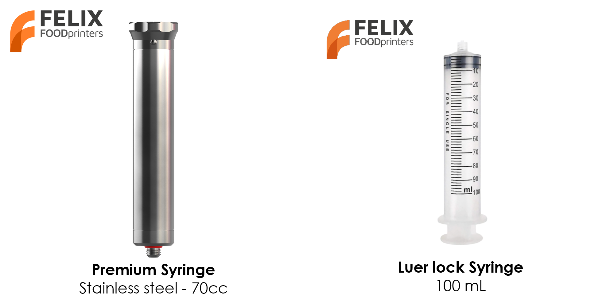
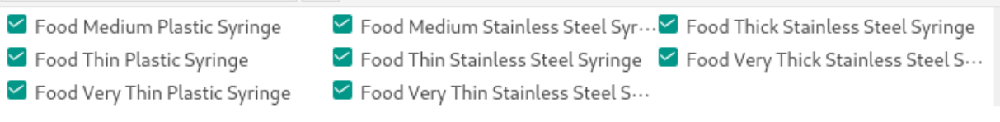

# Printing foods with orca slicer

In this guide we will show you how to print food using our presets available in the Orca slicer.

## Introduction

We offer 2 ways of how food can be loaded into the printer and subsequently printed.

- plastic syringe (100 ml)
- premium stainless steel syringe (70 ml)

<figure markdown="span">
  { width="500" }
  <figcaption>Different syringe types</figcaption>
</figure>

Since orca is made to support only plastic printers sellecting different syringe types is not possible in the application. Therefore syringe types were embedded inside different materials types.

<figure markdown="span">
  { width="1000" }
  <figcaption>All filaments suitable for the food printers.</figcaption>
</figure>

In order to select the correct filament please consult the following table.

## Food Material Viscosity Classes

The name of the filament is based on the class it is most suited for.

While it is possible to mix and match materials, we do not guarantee the results.

### Basic Plastic: Plastic Syringe

| Level | Class     | Viscosity (mPa·s) | Examples                      |
| :---: | --------- | ----------------- | ----------------------------- |
|   3   | Medium    | 10,000 – 30,000   | Mustard, mayonnaise           |
|   2   | Thin      | 3,000 – 10,000    | Liquid honey, custard         |
|   1   | Very Thin | 1,000 – 3,000     | Molten chocolate, thick syrup |

### Premium Stainless Steel: Stainless Steel Syringe

| Level | Class      | Viscosity (mPa·s) | Examples                               |
| :---: | ---------- | ----------------- | -------------------------------------- |
|   5   | Very Thick | 100,000 – 300,000 | Thick peanut butter, soft cookie dough |
|   4   | Thick      | 30,000 – 100,000  | Tomato paste, thick Greek yogurt       |
|   3   | Medium     | 10,000 – 30,000   | Mustard, mayonnaise                    |
|   2   | Thin       | 3,000 – 10,000    | Liquid honey, custard                  |
|   1   | Very Thin  | 1,000 – 3,000     | Molten chocolate, thick syrup          |
