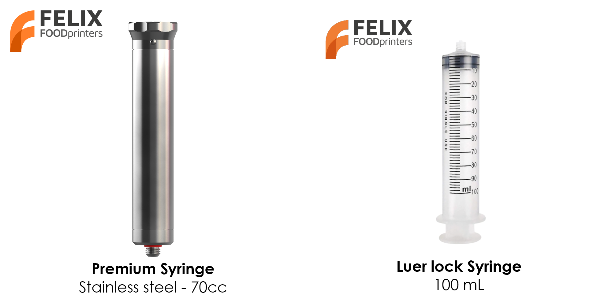
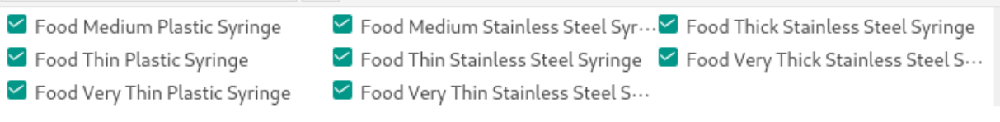

# Voedsel printen met OrcaSlicer

In deze handleiding laten we zien hoe je voedsel print met onze presets in OrcaSlicer.

## Introductie

Er zijn 2 manieren om voedsel in de printer te laden en te printen:

- kunststof spuit (100 ml)
- premium roestvrijstalen spuit (70 ml)

<figure markdown="span">
  { width="500" }
<figcaption>Verschillende soorten spuiten</figcaption>
</figure>

OrcaSlicer is gemaakt voor kunststofprinters, dus je kunt in de applicatie geen spuittype kiezen. Daarom zit het spuittype verwerkt in de verschillende materiaaltypes.

<figure markdown="span">
  { width="1000" }
<figcaption>Alle filamenten die geschikt zijn voor de voedselprinters.</figcaption>
</figure>

Gebruik de volgende tabel om het juiste filament te kiezen.

## Viscositeitsklassen voor voedselmaterialen

De naam van het filament is gebaseerd op de klasse waarvoor het het meest geschikt is.

### Basic kunststof: kunststof spuit

| Niveau | Klasse               | Viscositeit (mPa·s) | Voorbeelden                       |
| :----: | -------------------- | ------------------- | --------------------------------- |
|   3    | Medium (gemiddeld)   | 10.000 – 30.000     | Mosterd, mayonaise                |
|   2    | Thin (dun)           | 3.000 – 10.000      | Vloeibare honing, vla             |
|   1    | Very Thin (zeer dun) | 1.000 – 3.000       | Gesmolten chocolade, dikke siroop |

### Premium roestvrij staal: roestvrijstalen spuit

| Niveau | Klasse                | Viscositeit (mPa·s) | Voorbeelden                         |
| :----: | --------------------- | ------------------- | ----------------------------------- |
|   5    | Very Thick (zeer dik) | 100.000 – 300.000   | Dikke pindakaas, zacht koekjesdeeg  |
|   4    | Thick (dik)           | 30.000 – 100.000    | Tomatenpuree, dikke Griekse yoghurt |
|   3    | Medium (gemiddeld)    | 10.000 – 30.000     | Mosterd, mayonaise                  |
|   2    | Thin (dun)            | 3.000 – 10.000      | Vloeibare honing, vla               |
|   1    | Very Thin (zeer dun)  | 1.000 – 3.000       | Gesmolten chocolade, dikke siroop   |
