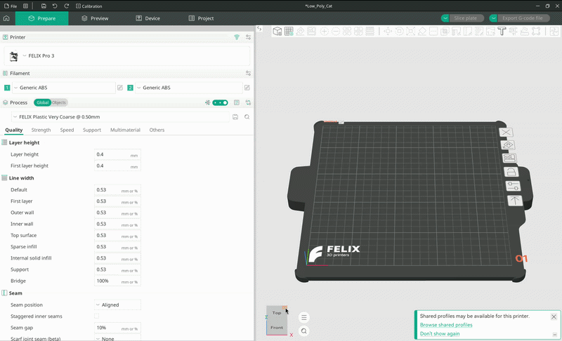
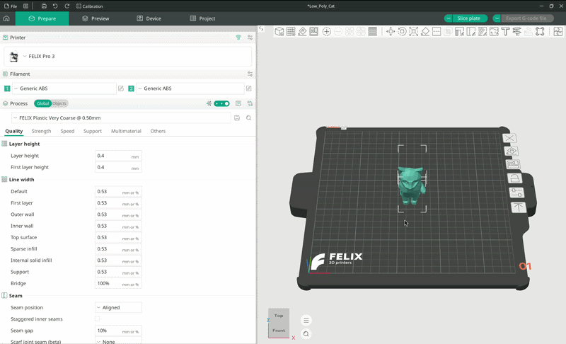
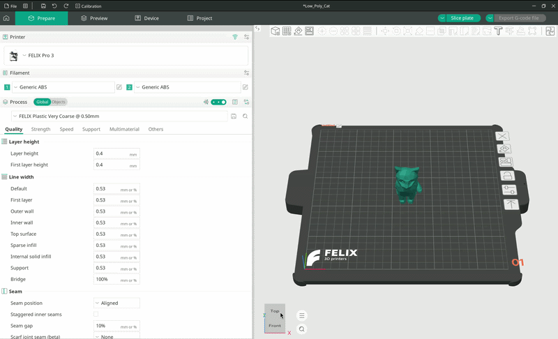
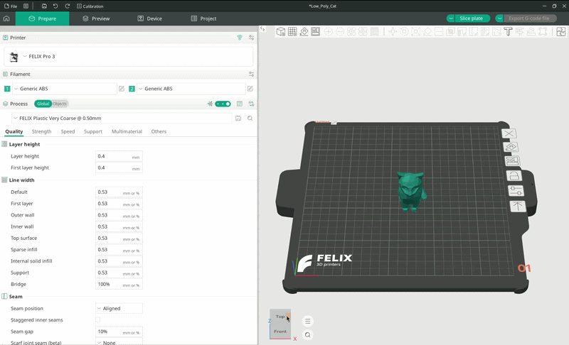
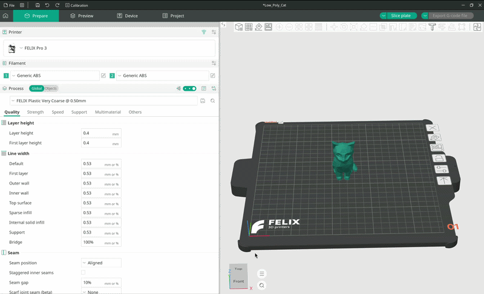
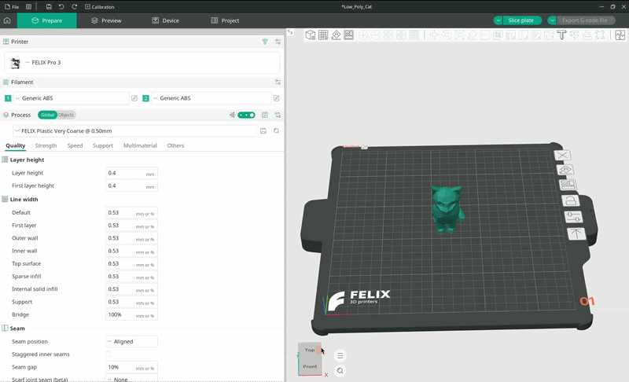
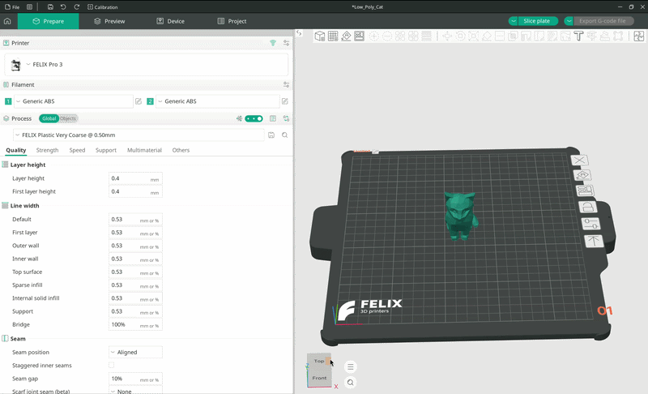
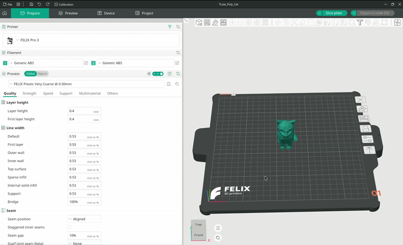

# Printing

This guide walks you through a simplified workflow: importing your model, positioning it on the bed, slicing it, and exporting the G-code so it can be loaded onto the printer and printed.

## Configuring the printer

If you haven't added your printer yet, follow the [Adding printers](./Adding%20printers.md) guide.

If you have added your printer but haven't configured it for printing yet, follow the [Configuring](./Configuring.md) guide.

### Quick start

To go from zero to a fully configured printer, follow these simple steps:

??? tip "Quick start guide"

    - Click the printer selection drop-down and select `-- Select/Remove printer (from system presets) --`.

    - Type `FELIX` into the search bar.

    - Select the printer(s) you want to use in OrcaSlicer.

    - Press `Next`.

    - Under the `Filament` tab, open the filament drop-down menu and select `-- Add/Remove filament --`.

    - In the pop-up, look for the correct nozzle/filament type combination provided by FELIX Printers.

    - Select the filament(s) you want to use.

    - In the process tab, select the quality preset you would like to use. More detailed prints take longer to finish, and vice versa.

    - You're all set!

## Importing the model

OrcaSlicer supports a variety of 3D model formats, which it slices into instructions for the printer.

There are several ways to import a model into OrcaSlicer, but the most straightforward is to click the small cube icon with a plus sign in the top toolbar.

This opens a file explorer dialog where you can browse the files on your computer. Navigate to the location where your model is saved, then either double-click it or select it and press `Open`.

The file browser will close, and your model will appear in OrcaSlicer.

<figure markdown="span">
  { width="1000" }
  <figcaption>Importing a model</figcaption>
</figure>

## Positioning your model

You can position your model on the print bed using several tools, also available from the top toolbar.

### Translation (Move)

There are multiple ways to position your model on the print bed.

**Drag and drop**

You can simply drag the model around the print bed. This is the **default** behavior when a model is selected. While convenient, it isn't very precise.

<figure markdown="span">
  { width="1000" }
  <figcaption>Positioning a model with drag and drop</figcaption>
</figure>

**Move tool**

!!! tip

    Press `M` on your keyboard to quickly enable the move tool.

Another way to move the model on the print bed is with the **move tool**. You can enable it from the top toolbar; its icon is a small square with arrows pointing in each of the four directions.

Once the move tool is active, you will see the move gizmo: three arrows, each pointing along one axis of the coordinate system (`X`, `Y`, `Z`).

The gizmo lets you position the model as precisely as you need.

<figure markdown="span">
  { width="1000" }
  <figcaption>Different ways to move your model on the print bed</figcaption>
</figure>

**Local vs. world coordinate space**

In most cases, you will want to use the world coordinate system.

??? Optional "What are coordinate systems?"

    Every point in a 3D scene has to be expressed relative to some coordinate system.

    When a 3D model is created, it is defined in its own `local` coordinate system.

    That coordinate system is mainly useful while the model is being created. Once you place the model into a scene, its position is expressed relative to another coordinate system: the world coordinate system.

    When positioning a model, you will almost always want the world coordinate system since, as the name suggests, it represents your world, i.e. the print bed where your model will be printed.

### Rotation

To enable rotation, click the icon showing a small square with an arrow orbiting around it.

Rotation gizmos will appear, allowing you to rotate your object around the three main axes of rotation:

- Yaw (around the object's up direction, X)
- Pitch (around the object's right direction, Z)
- Roll (around the forward direction, in our case positive Y)

To rotate the object, drag the desired gizmo in the direction you want to rotate it.

<figure markdown="span">
  { width="1000" }
  <figcaption>Rotating a model</figcaption>
</figure>

### Scale

As the name suggests, this tool lets you make your model smaller or bigger.

To enter scaling mode, click the icon showing a small square inside a larger dashed square, with arrows connecting their corners.

The scaling gizmo works much like the ones in 2D image editors. Dragging a corner of the gizmo scales the model uniformly in all directions, while dragging a side scales it in only one direction (`X` or `Y`).

<figure markdown="span">
  { width="1000" }
  <figcaption>Uniform scaling using gizmos</figcaption>
</figure>

<figure markdown="span">
  { width="1000" }
  <figcaption>Non-uniform scaling using gizmos</figcaption>
</figure>

!!! note

    Uniform scaling affects the model equally in every direction.

You can also scale the model by percentage in the small pop-up window. By default, the model is at 100% scale.

For example, to make the model half its size, type 50 into the `X`, `Y`, and `Z` boxes. If uniform scaling is enabled, you can type the value into any one of the three boxes and it will be applied to the whole model.

<figure markdown="span">
  { width="1000" }
  <figcaption>Uniform and non-uniform scaling using percentages</figcaption>
</figure>

### Lay on face

As the name suggests, this tool lays the model flat on one of its faces. OrcaSlicer detects which faces the model can rest on; for a pentahedron, for example, you can choose any of its five faces.

<figure markdown="span">
  { width="1000" }
  <figcaption>Demonstration of the lay on face tool</figcaption>
</figure>

There are also some more advanced tools you can use, such as:

- **Cut**, which cuts the selected model just as you would with a knife.

- **Mesh boolean**, which lets you perform boolean operations on meshes, such as cutting holes into one object using another.

- **Support painting**, which lets you paint supports manually if automatic supports don't work for you.

- And more.

For the full list of features, see the [OrcaSlicer wiki](https://www.orcaslicer.com/wiki/print_prepare/prepare_basic.html).

!!! tip

    The best way to learn these tools is simply to experiment with them.
