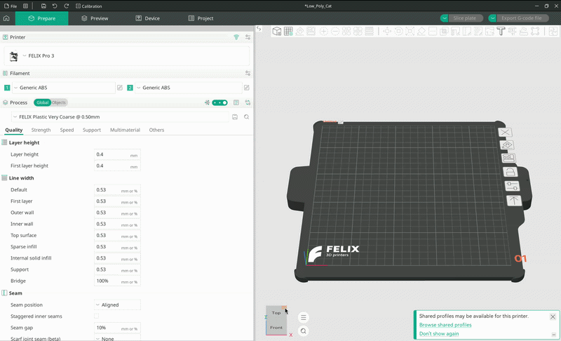
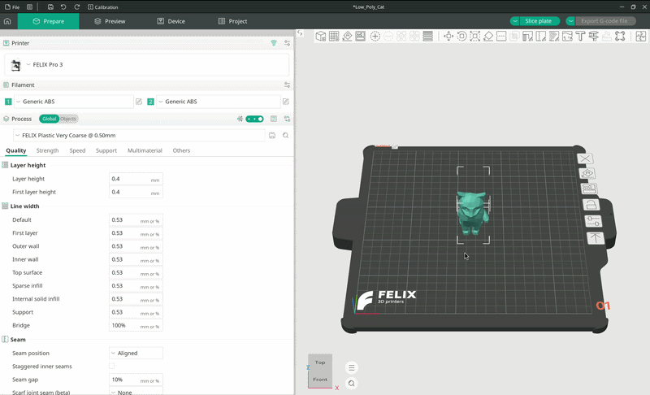
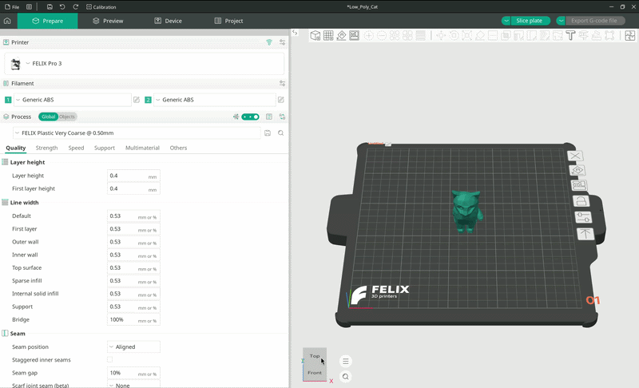
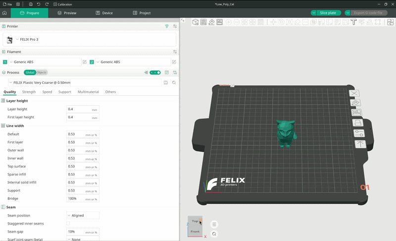
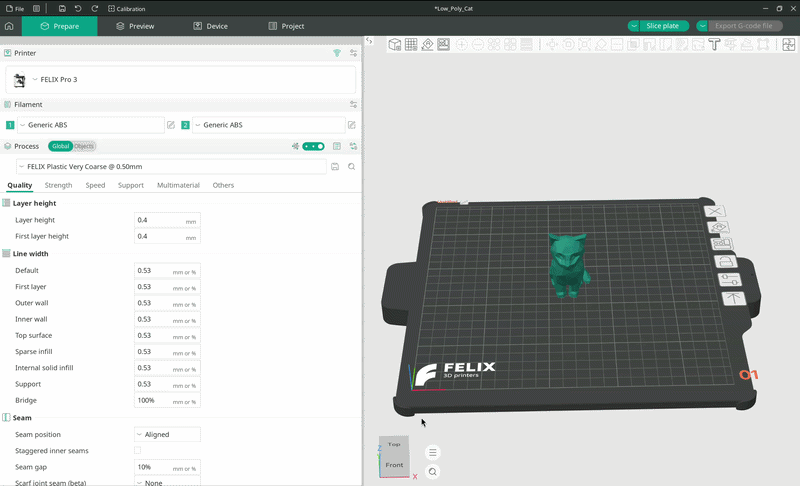
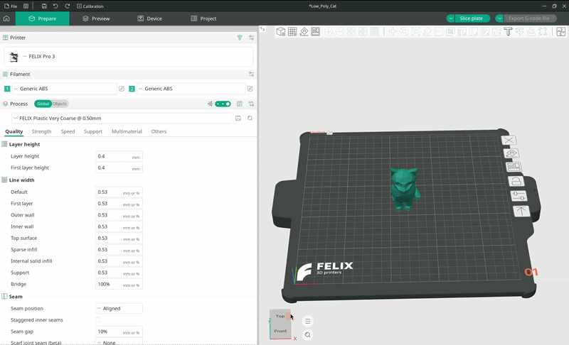
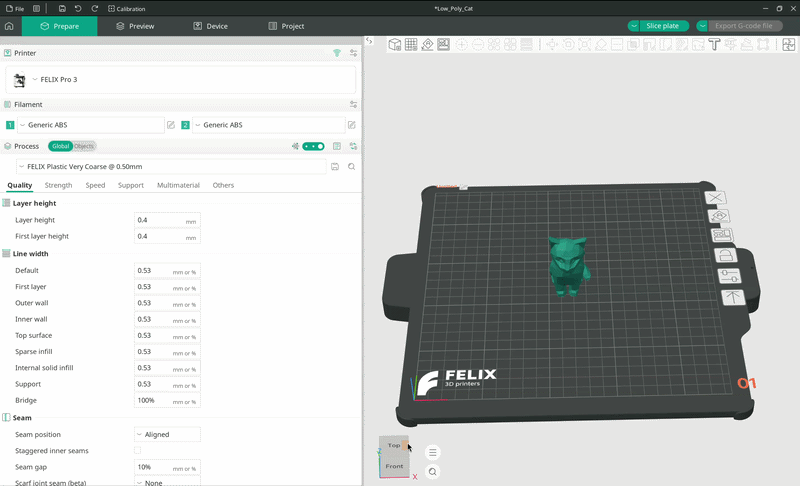
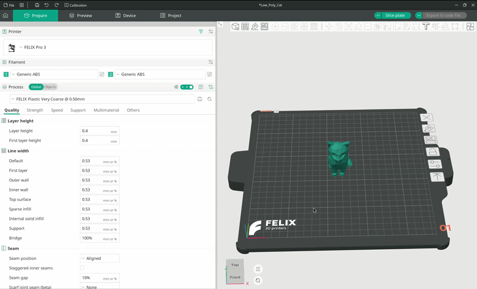

# Printen

Deze handleiding leidt je door een vereenvoudigde werkwijze: je model importeren, het op het printbed positioneren, het slicen en de G-code exporteren, zodat deze op de printer kan worden geladen en geprint.

## De printer configureren

Als je je printer nog niet hebt toegevoegd, volg dan de handleiding [Printers toevoegen](./Adding%20printers.md).

Als je je printer al hebt toegevoegd maar nog niet hebt geconfigureerd om te printen, volg dan de handleiding [Configureren](./Configuring.md).

### Snel aan de slag

Volg deze eenvoudige stappen om in een paar minuten een volledig geconfigureerde printer te hebben:

??? tip "Snelstartgids"

    - Klik op het vervolgkeuzemenu voor de printerselectie en kies `-- Select/Remove printer (from system presets) --`.

    - Typ `FELIX` in de zoekbalk.

    - Selecteer de printer(s) die je in OrcaSlicer wilt gebruiken.

    - Druk op `Next`.

    - Open onder het tabblad `Filament` het vervolgkeuzemenu voor filament en kies `-- Add/Remove filament --`.

    - Zoek in het pop-upvenster naar de juiste combinatie van nozzle en filamenttype van FELIX Printers.

    - Selecteer het filament (of de filamenten) dat je wilt gebruiken.

    - Kies in het procestabblad de kwaliteitsinstelling die je wilt gebruiken. Gedetailleerdere prints duren langer, en omgekeerd.

    - Je bent klaar!

## Het model importeren

OrcaSlicer ondersteunt verschillende 3D-modelformaten, die het slicet tot instructies voor de printer.

Er zijn meerdere manieren om een model in OrcaSlicer te importeren, maar de eenvoudigste is door op het kleine kubusicoon met een plusteken in de bovenste werkbalk te klikken.

Hiermee open je een bestandsverkenner waarin je door de bestanden op je computer kunt bladeren. Navigeer naar de locatie waar je model is opgeslagen en dubbelklik erop, of selecteer het en druk op `Open`.

De bestandsverkenner sluit en je model verschijnt in OrcaSlicer.

<figure markdown="span">
  { width="1000" }
  <figcaption>Een model importeren</figcaption>
</figure>

## Je model positioneren

Je kunt je model op het printbed positioneren met verschillende tools, die ook via de bovenste werkbalk beschikbaar zijn.

### Verplaatsen (Move)

Er zijn meerdere manieren om je model op het printbed te positioneren.

**Slepen en neerzetten**

Je kunt het model eenvoudig over het printbed slepen. Dit is het **standaardgedrag** wanneer een model is geselecteerd. Het is handig, maar niet erg nauwkeurig.

<figure markdown="span">
  { width="1000" }
  <figcaption>Een model positioneren door te slepen en neer te zetten</figcaption>
</figure>

**Verplaatstool**

!!! tip

    Druk op `M` op je toetsenbord om de verplaatstool snel te activeren.

Een andere manier om het model op het printbed te verplaatsen is met de **verplaatstool**. Je activeert deze via de bovenste werkbalk; het icoon is een klein vierkant met pijlen die in alle vier de richtingen wijzen.

Zodra de verplaatstool actief is, zie je de verplaatsgizmo: drie pijlen die elk langs één as van het coördinatenstelsel wijzen (`X`, `Y`, `Z`).

Met de gizmo kun je het model zo nauwkeurig positioneren als je nodig hebt.

<figure markdown="span">
  { width="1000" }
  <figcaption>Verschillende manieren om je model op het printbed te verplaatsen</figcaption>
</figure>

**Lokaal vs. wereldcoördinatenstelsel**

In de meeste gevallen wil je het wereldcoördinatenstelsel gebruiken.

??? Optional "Wat zijn coördinatenstelsels?"

    Elk punt in een 3D-omgeving moet worden uitgedrukt ten opzichte van een bepaald coördinatenstelsel.

    Wanneer een 3D-model wordt gemaakt, wordt het gedefinieerd in zijn eigen `lokale` coördinatenstelsel.

    Dat coördinatenstelsel is vooral nuttig tijdens het maken van het model. Zodra je het model in een omgeving plaatst, wordt de positie ervan uitgedrukt ten opzichte van een ander coördinatenstelsel: het wereldcoördinatenstelsel.

    Bij het positioneren van een model wil je bijna altijd het wereldcoördinatenstelsel gebruiken, omdat dit, zoals de naam al zegt, jouw wereld voorstelt, oftewel het printbed waarop je model wordt geprint.

### Roteren

Klik op het icoon met een klein vierkant waar een pijl omheen draait om de rotatietool te activeren.

Er verschijnen rotatiegizmo's waarmee je je object rond de drie hoofdassen kunt draaien:

- Yaw (rond de opwaartse richting van het object, X)
- Pitch (rond de rechterrichting van het object, Z)
- Roll (rond de voorwaartse richting, in ons geval positief Y)

Sleep de gewenste gizmo in de richting waarin je het object wilt draaien.

<figure markdown="span">
  { width="1000" }
  <figcaption>Een model roteren</figcaption>
</figure>

### Schalen

Zoals de naam al zegt, kun je met deze tool je model kleiner of groter maken.

Klik op het icoon met een klein vierkant binnen een groter gestippeld vierkant, met pijlen die de hoeken verbinden, om de schaalmodus te openen.

De schaalgizmo werkt grotendeels zoals die in 2D-beeldbewerkingsprogramma's. Door aan een hoek van de gizmo te slepen, schaal je het model gelijkmatig in alle richtingen. Door aan een zijkant te slepen, schaal je het in slechts één richting (`X` of `Y`).

<figure markdown="span">
  { width="1000" }
  <figcaption>Gelijkmatig schalen met gizmo's</figcaption>
</figure>

<figure markdown="span">
  { width="1000" }
  <figcaption>Ongelijkmatig schalen met gizmo's</figcaption>
</figure>

!!! note

    Gelijkmatig schalen beïnvloedt het model in elke richting evenveel.

Je kunt het model ook schalen op basis van een percentage in het kleine pop-upvenster. Standaard staat het model op 100% schaal.

Om het model bijvoorbeeld half zo groot te maken, typ je 50 in de vakken `X`, `Y` en `Z`. Als gelijkmatig schalen is ingeschakeld, kun je de waarde in een willekeurig van de drie vakken typen en wordt deze op het hele model toegepast.

<figure markdown="span">
  { width="1000" }
  <figcaption>Gelijkmatig en ongelijkmatig schalen met percentages</figcaption>
</figure>

### Op vlak leggen (Lay on face)

Zoals de naam al zegt, legt deze tool het model plat op een van zijn vlakken. OrcaSlicer detecteert op welke vlakken het model kan rusten; bij een pentaëder kun je bijvoorbeeld kiezen uit alle vijf de vlakken.

<figure markdown="span">
  { width="1000" }
  <figcaption>Demonstratie van de tool Op vlak leggen</figcaption>
</figure>

Er zijn ook enkele geavanceerdere tools die je kunt gebruiken, zoals:

- **Snijden (Cut)**, waarmee je het geselecteerde model doorsnijdt, net zoals je met een mes zou doen.

- **Mesh-booleaans (Mesh boolean)**, waarmee je booleaanse bewerkingen op meshes uitvoert, zoals gaten in een object maken met behulp van een ander object.

- **Supports schilderen (Support painting)**, waarmee je handmatig supports kunt schilderen als automatische supports niet goed werken.

- En meer.

Raadpleeg de [OrcaSlicer-wiki](https://www.orcaslicer.com/wiki/print_prepare/prepare_basic.html) voor de volledige lijst met functies.

!!! tip

    De beste manier om deze tools te leren kennen, is er simpelweg mee te experimenteren.
