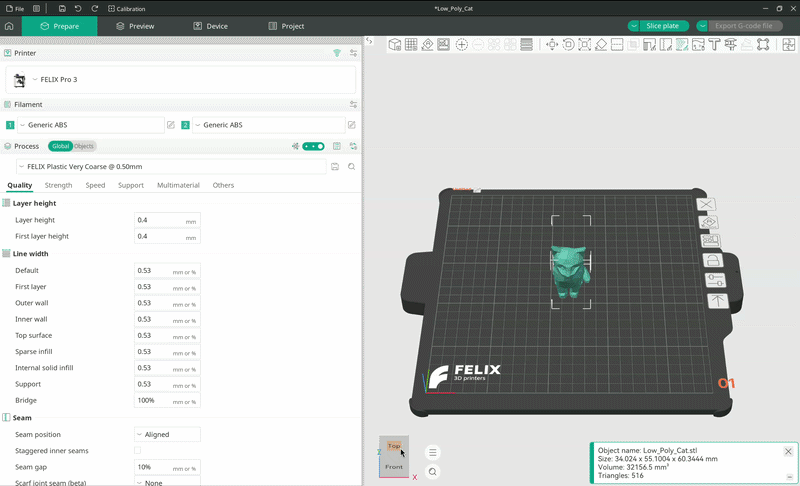
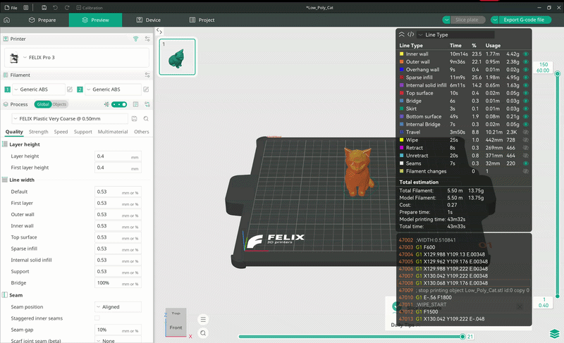

# Slicing

Slicing is the process of converting your model into instructions that our printers can understand.

The slicer outputs a file containing a list of instructions along with various metadata for the printer. This file is called a G-code file and usually has the extension `.gcode` or `.gx`.

OrcaSlicer makes this process as simple as clicking a single button.

Before continuing with this guide, make sure your model is prepared for slicing. You can learn how to do that in the [Printing guide](./Printing.md).

---

To slice your model, click the `Slice plate` button in the top-right corner of the screen.

<figure markdown="span">
  { width="1000" }
  <figcaption>Slicing a model</figcaption>
</figure>

!!! warning

    Depending on the complexity of the model and the selected process (quality preset), slicing can take several minutes, and in extreme cases even hours.

## Print preview

Once the model has been sliced, you will automatically be taken to the preview panel.

If not, press `Tab` on your keyboard or select `Preview` in the top menu bar. Here you can examine the paths your printer will follow.

### Horizontal slider

The horizontal slider shows the progress within the current layer. It lets you see how the extruder moves on that layer and in which order it deposits material on the print bed.

You can play it back as a timelapse or drag the slider with your mouse.

### Vertical slider

The vertical slider lets you switch between layers. Unlike the horizontal slider, it can't be played back as a timelapse.

Use this slider to see how your model will be printed on the inside. You can inspect the infill pattern, as well as supports and inner walls.

## Exporting the G-code

Once you are happy with the result, click `Export G-code file`.

This opens the same file browser you used when importing your model. This time, navigate to the location on your computer where you want to save the G-code file, then press `Save`.

<figure markdown="span">
  { width="1000" }
  <figcaption>Exporting the G-code</figcaption>
</figure>
