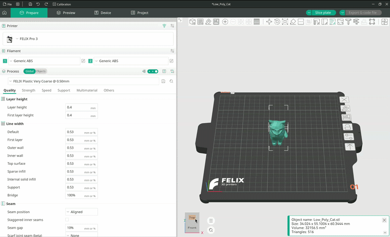

# Slicen

Slicen is het proces waarbij je model wordt omgezet in instructies die onze printers kunnen begrijpen.

De slicer levert een bestand op met een lijst instructies en diverse metadata voor de printer. Dit bestand heet een G-codebestand en heeft meestal de extensie `.gcode` of `.gx`.

Met OrcaSlicer is dit proces zo eenvoudig als op één knop klikken.

Zorg ervoor dat je model klaar is om te slicen voordat je verdergaat met deze handleiding. Hoe je dat doet, lees je in de [Printhandleiding](./Printing.md).

---

Om je model te slicen, klik je op de knop `Slice plate` rechtsboven in het scherm.

<figure markdown="span">
  { width="1000" }
  <figcaption>Een model slicen</figcaption>
</figure>

!!! warning "Let op"

    Afhankelijk van de complexiteit van het model en het geselecteerde proces (kwaliteitsinstelling) kan het slicen enkele minuten duren, en in extreme gevallen zelfs uren.

## Printvoorbeeld

Zodra het model is gesliced, word je automatisch naar het voorbeeldpaneel geleid.

Gebeurt dat niet, druk dan op `Tab` op je toetsenbord of selecteer `Preview` in de bovenste menubalk. Hier kun je de paden bekijken die je printer gaat volgen.

### Horizontale schuifregelaar

De horizontale schuifregelaar toont de voortgang binnen de huidige laag. Zo zie je hoe de extruder over die laag beweegt en in welke volgorde het materiaal op het printbed wordt aangebracht.

Je kunt dit afspelen als timelapse of de schuifregelaar met je muis verslepen.

### Verticale schuifregelaar

Met de verticale schuifregelaar wissel je tussen lagen. In tegenstelling tot de horizontale schuifregelaar kun je deze niet als timelapse afspelen.

Gebruik deze schuifregelaar om te zien hoe je model aan de binnenkant wordt geprint. Je kunt het vulpatroon (infill) bekijken, evenals de supports en binnenwanden.

## De G-code exporteren

Ben je tevreden met het resultaat, klik dan op `Export G-code file`.

Hiermee open je dezelfde bestandsverkenner die je gebruikte bij het importeren van je model. Navigeer deze keer naar de locatie op je computer waar je het G-codebestand wilt opslaan en druk op `Save`.;width="1000" }

  <figcaption>De G-code exporteren</figcaption>
</figure>
